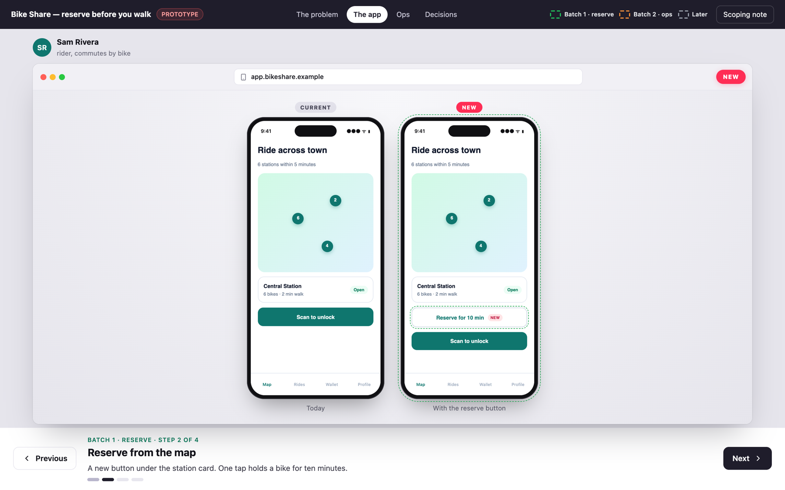

# html-design-proto

A small engine for clickable design prototypes: one HTML file that replays your app's real screens, step by step, so people can settle a product decision without reading a spec.

It handles everything around the screens: the scenario tabs, the narration bar, keyboard navigation, the browser and phone frames, the CURRENT / NEW tags, the colour-coded batches, and the slide blocks for the problem and the decision. You only write the screens and the story.

**[Live demo](https://snowpact.github.io/html-design-proto/demo/)**



It pairs with the [`design-prototype`](https://github.com/snowpact/snowpact-skills) agent skill, which tells Claude Code, Codex and friends how to build these prototypes from your codebase.

## How a project is laid out

```
docs/features/
  _kit/                         shared by every prototype of the project
    app.css                     your app's look, reproduced once
    screens.js                  screens and data used by two prototypes or more
    assets.js                   logos and photos as data URIs (const ASSETS = {...})
  notifications/
    prototype.scenario.js       the story: screens specific to it + DesignProto.init(...)
    prototype.html              generated, standalone, the file you open or send
```

Build the HTML with Node (no install, nothing to publish):

```bash
npx -y github:snowpact/html-design-proto build docs/features/notifications/prototype.scenario.js
```

The command finds the nearest `_kit/` folder, inlines it, checks every script for syntax errors, and writes `prototype.html`. The engine itself loads from jsDelivr, pinned to the version that built the file. Add `--inline` to embed the engine too (for offline use or local development).

## A scenario

```js
DesignProto.init({
  lang: "en",                       // "en" or "fr" for the built-in labels
  title: "Bike Share — reserve before you walk",
  url: "app.bikeshare.example",     // default URL shown in the browser frame
  links: [{ label: "Scoping note", href: "scoping.md" }],
  lots: [{ id: 1, label: "reserve" }, { id: 2, label: "ops" }, { id: "later", label: "Later" }],
  personas: { sam: { name: "Sam Rivera", role: "rider", color: "#0f766e" } },
  scenarios: [
    { tab: "The problem", steps: [
      { kicker: "The problem", title: "The bike is gone when you get there", text: "Two sentences of narration.",
        slide: () => DesignProto.board("The bike is gone", "Lead paragraph.", DesignProto.flow([...]), DesignProto.cards([...])) },
    ] },
    { tab: "The app", persona: "sam", steps: [
      { kicker: "Today", title: "Find a station, then hope", text: "…", tag: "now", phones: [mapScreen()] },
      { kicker: "Batch 1", lot: 1, title: "Reserve from the map", text: "…", tag: "new",
        phones: [{ html: mapScreen(), tag: "now", caption: "Today" }, { html: mapScreen({ reserve: true }), tag: "new", highlight: true }] },
    ] },
  ],
});
```

### Steps

| Field | What it does |
|---|---|
| `kicker`, `title`, `text` | The narration bar: small label, title, two sentences. |
| `tag` | `"now"` (grey CURRENT) or `"new"` (pink NEW) on the window. |
| `lot` | Colours the kicker with the batch colour. |
| `persona` | A key of `personas`, or an object `{ name, role, color }`. Defaults to the scenario's. |
| `screen` | HTML string or function, shown in a browser window. |
| `phones` | A list of phones, shown side by side in the window. |
| `phonesOptions` | `{ arrows, scale, gap }` for that list. |
| `slide` | HTML string or function, shown as a full-page slide instead of a window. |
| `frame: "bare"` | A window without the browser bar. |
| `url`, `urlIcon` | URL bar text and icon (`lock`, `phone`, `mail`, `globe`). |
| `focus` | CSS selector scrolled into view after render. |

### Phones

Each phone is an HTML string or an object:

| Field | Default | |
|---|---|---|
| `html` | | The screen body. |
| `tabBar` | none | HTML for your app's bottom bar. |
| `device` | `"ios"` | `"android"` swaps the notch for a punch hole. |
| `time` | `"9:41"` | Status bar clock. |
| `dark` | `false` | White status bar text, for dark headers. |
| `bg` | white | Screen background. |
| `caption` | none | Text under the phone. |
| `tag` | none | `"now"` or `"new"` above the phone. |
| `highlight`, `lot` | | Dashed outline around the phone, in the batch colour. |
| `scale` | `.76` | Shrink or grow; phones shrink to `.7` automatically when they carry a tag or a caption. |

`DesignProto.phone(spec)` and `DesignProto.phones(list, opts)` return HTML, so you can also wrap them in your own helpers.

### Slide blocks

All of them return HTML strings you can mix with your own markup.

- `board(title, lead, ...blocks)`: the slide itself.
- `flow([{ title, text, kind }])`: a journey as chips and arrows; `kind` is `"q"` (highlighted) or `"ko"` (broken).
- `cards([{ title, tag, items, pros, cons, win }])`: two or three cards; `win` outlines the recommended one.
- `table(head, rows)`: a plain matrix.
- `verdict(text, icon)`: the recommendation banner.
- `lots([{ lot, num, title, state, items }])`: the delivery plan.
- `state("ok" | "todo" | "warn", label)`, `yes(label)`, `no(label)`, `mark()`, `lotChip(id)`: small pills.

Mark new parts inside your own screens with the `dp-new` class (dashed outline) and `DesignProto.mark()` (NEW pill).

### Navigation

← → keys, the dots, and the tabs. The URL hash keeps the position (`#2.3` is scenario 3, step 4), so a link opens the right step.

## Styling

Every engine class starts with `dp-`, so your app's CSS can't clash with it. Theme the shell through CSS variables (`--dp-chrome`, `--dp-accent`, `--dp-new`, `--dp-font`…) in `_kit/app.css`.

## License

MIT
